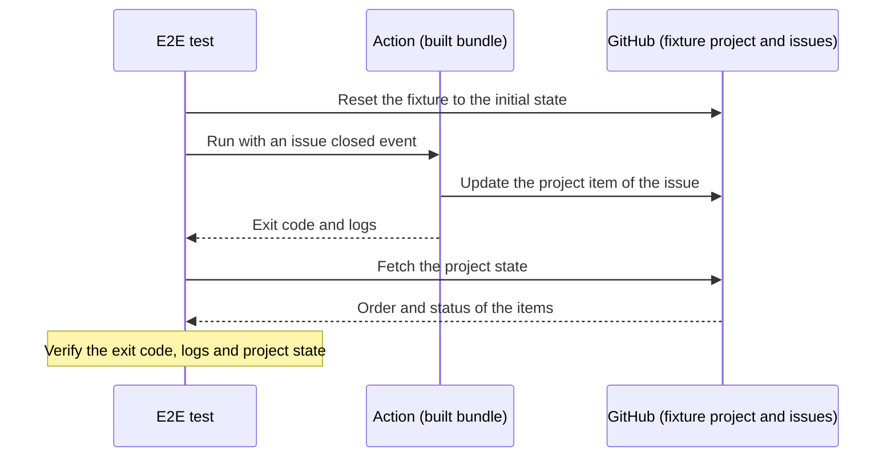

# E2E tests

The e2e tests run the built `dist/index.js` against the fixture project [wozaki/projects/8](https://github.com/users/wozaki/projects/8) and check the result with the GitHub API.

They catch what unit tests can't: bundling regressions after a dependency update, authentication with the `github-token` input, and changes in the behavior of the Projects V2 API.

Each test gives the action the same environment variables as the Actions runner does for the usage in README (`organization` omitted, `status-name` default), with an `issues.closed` event payload of a fixture issue.
The environment of the test process is not passed to the action.



Each test case runs this sequence. Which fixtures and API calls each step uses is defined in `fixture.ts` and the tests.

## Running locally

```bash
pnpm build
E2E_GITHUB_TOKEN="$(gh auth token)" pnpm e2e
```

The token needs the `project` scope.

## CI

`.github/workflows/e2e.yaml` runs on pull requests and pushes that change the action, weekly, and on demand.
It uses the repository secret `E2E_GITHUB_TOKEN`, a classic personal access token with the `project` scope.
Pull requests from forks skip it, since they cannot access the secret.

The weekly run notices GitHub API changes that no pull request would trigger.

## Fixture setup

The tests reset the status and position of the fixture items before each test. Don't edit them by hand except as described here.

### Project

[wozaki/projects/8](https://github.com/users/wozaki/projects/8) is a public project with the default `Status` field (`Todo`, `In Progress`, `Done`). It is used only by these tests.

### Issues

The closed issues labeled `e2e-move-to-top` in [wozaki/sandbox-issue](https://github.com/wozaki/sandbox-issue/issues?q=label%3Ae2e-move-to-top). They are listed in `fixture.ts`.

| Issue | In the project | Role |
|---|---|---|
| [#70](https://github.com/wozaki/sandbox-issue/issues/70) `[e2e move-to-top] anchor (kept in Done)` | Yes | Kept at the top in Done, so that the issue under test starts below another item |
| [#71](https://github.com/wozaki/sandbox-issue/issues/71) `[e2e move-to-top] status Todo, moves to top as Done` | Yes | Starts in Todo, moved to the top and updated to Done |
| [#72](https://github.com/wozaki/sandbox-issue/issues/72) `[e2e move-to-top] status Done, moves to top` | Yes | Starts in Done, moved to the top without updating the status |
| [#73](https://github.com/wozaki/sandbox-issue/issues/73) `[e2e move-to-top] not in project` | No | Skipped by the action |

wozaki is a user, not an organization, so every test also goes through the fallback from the organization query to the user query.
